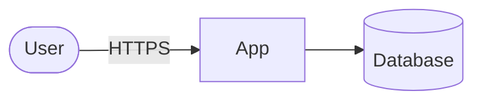

# TM: Title

| Scope | Requirement | Date | Reviewed by | Revisit when |
|---|---|---|---|---|
| <!-- FILL --> | <!-- FILL: REQ ID --> | <!-- FILL --> | <!-- FILL: people, not only developers --> | <!-- FILL: e.g. new data, new integration --> |

## 1. What are we working on?

<!-- FILL: replace the diagram; mark trust boundaries. List the assets worth protecting and the data that
crosses each boundary. -->

## 2. What can go wrong?

| ID | Element or flow | Category (STRIDE / LINDDUN) | Threat scenario | Likelihood | Impact | Risk |
|---|---|---|---|---|---|---|

## 3. What are we going to do about it?

| ID | Response (mitigate, eliminate, transfer, accept) | Mitigation or reason | Owner | Requirement / test |
|---|---|---|---|---|

## 4. Did we do a good job?

<!-- FILL: what wasn't covered, assumptions, and open questions. -->
