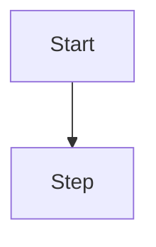

# FLOW: Title

| Requirement | Users | Devices | Status |
|---|---|---|---|
| <!-- FILL: REQ ID --> | <!-- FILL: who --> | <!-- FILL: mobile, desktop --> | Draft |

## Entry points

<!-- FILL: how users get to this flow. -->

## Flow

<!-- FILL: replace the diagram, then list the steps:
1. User sees … / does … / system does …
-->

## Screens and states

| Screen | Empty / first use | Loading | Error | Success | No permission |
|---|---|---|---|---|---|

## Copy

| Where | Text |
|---|---|

## Validation

| Field | Rule | When | Message |
|---|---|---|---|

## Edge cases

<!-- FILL: long text, many items, slow network, double submit, session expiry, … -->

## Acceptance criteria covered

| Criterion | Step |
|---|---|

## Open questions

<!-- FILL: questions with an owner. -->
